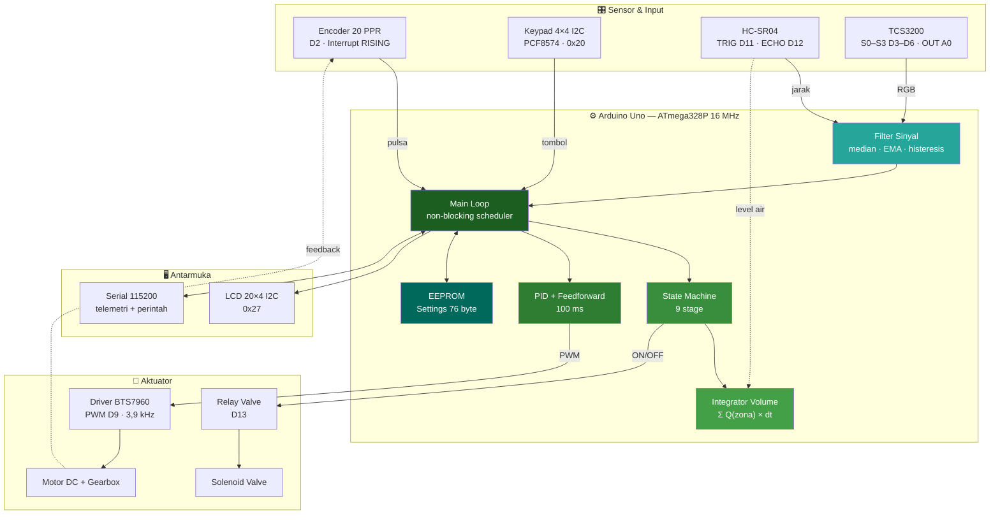
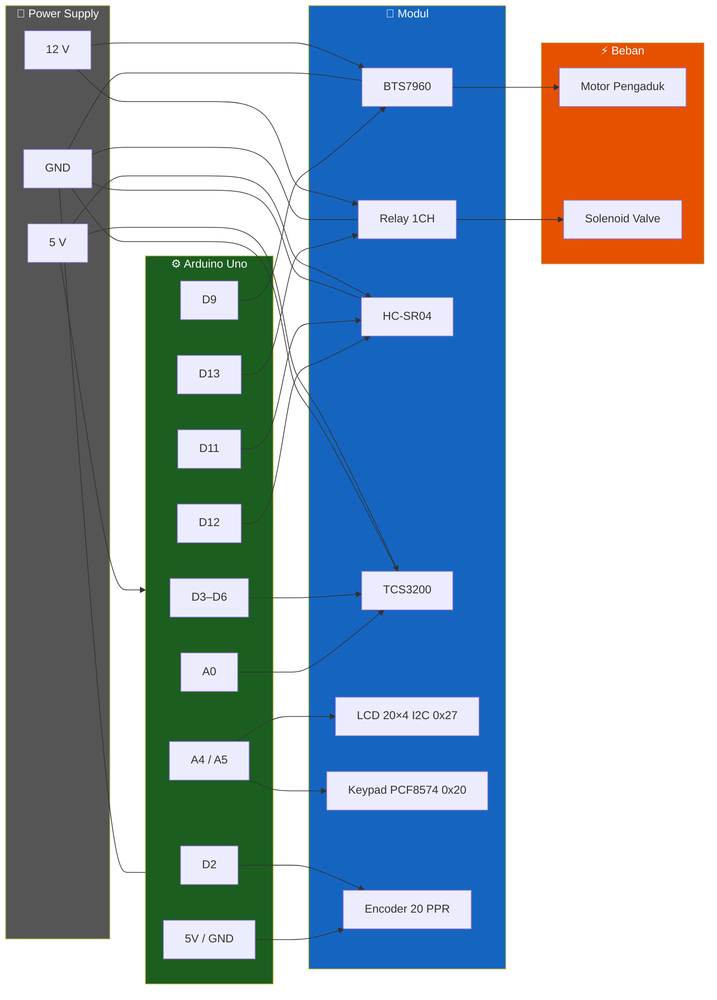
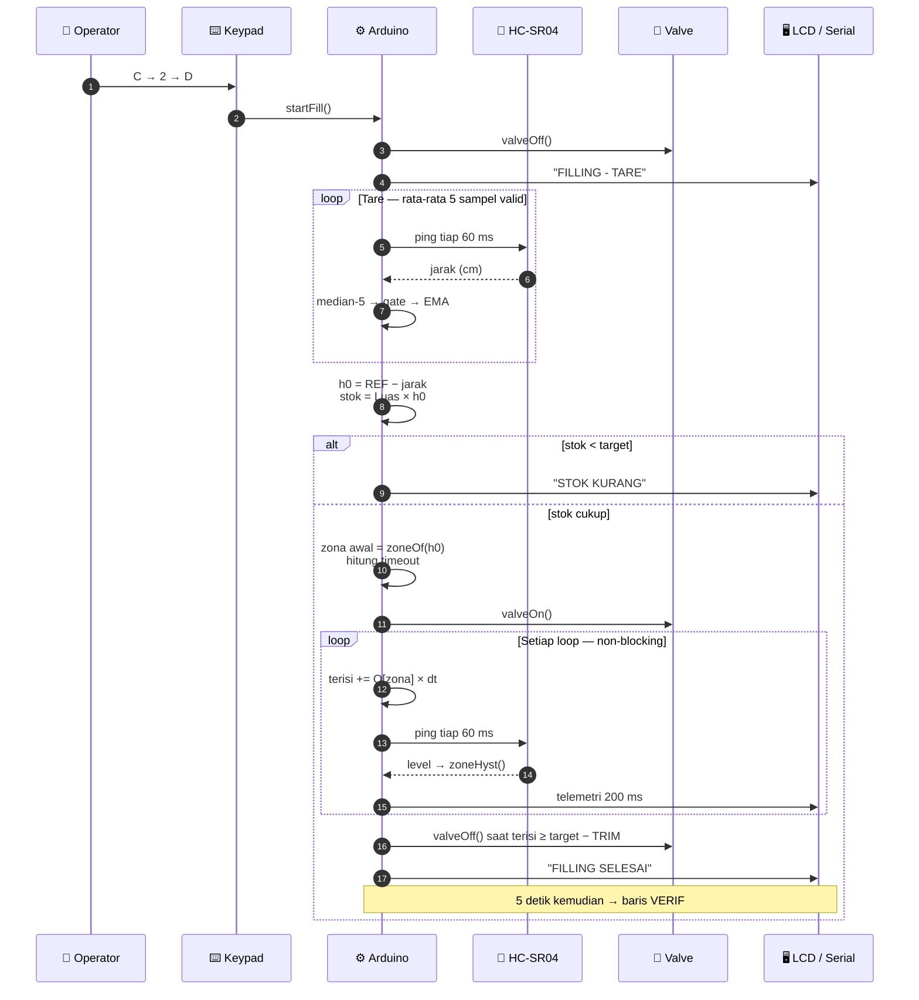
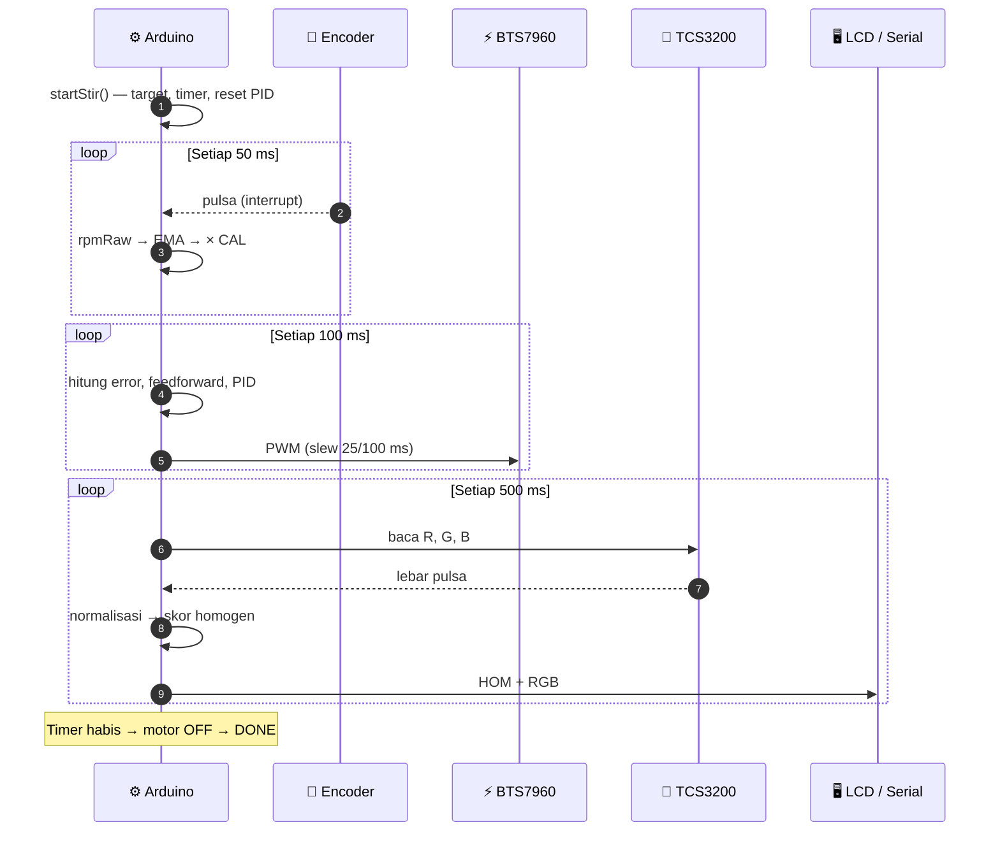
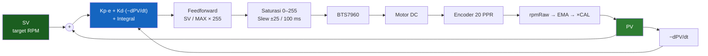
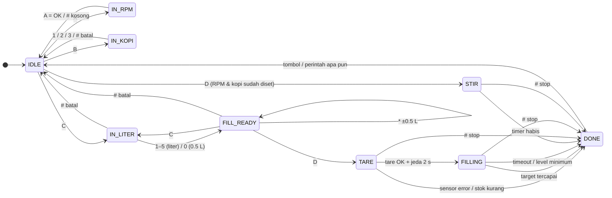
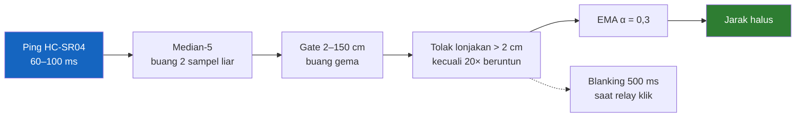
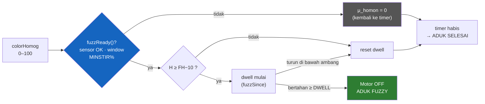

<div align="center">

# ☕ Mixer Kopi & Filling Otomatis

**Pengaduk kopi berbasis PID dengan pengisian cairan timer 10 zona**  
Arduino Uno · BTS7960 · HC-SR04 · TCS3200 · LCD 20×4 I2C

<br>

| | |
|---|---|
| **👤 Pengembang** | Yoga |
| **🏫 Kampus** | Politeknik Negeri Malang |
| **🔧 Board** | Arduino Uno (ATmega328P) |
| **📅 Tahun** | 2026 |

<br>

[](https://www.arduino.cc/)
[](https://www.arduino.cc/reference/en/)
[](LICENSE)
[](https://github.com/fahrizapro/MixerKopiFilling/commits/main)
[]()
[]()

</div>

---

## 📋 Daftar Isi

- [✨ Fitur](#-fitur)
- [🏗️ Arsitektur Sistem](#️-arsitektur-sistem)
- [🔌 Perangkat Keras](#-perangkat-keras)
- [📡 Alur Data](#-alur-data)
- [🔄 State Machine](#-state-machine)
- [📁 Struktur Proyek](#-struktur-proyek)
- [💻 Perangkat Lunak](#-perangkat-lunak)
- [🚀 Cara Pakai](#-cara-pakai)
- [⌨️ Panduan Keypad](#️-panduan-keypad)
- [🖥️ Perintah Serial](#️-perintah-serial)
- [📊 Telemetri](#-telemetri)
- [⚙️ Logika Kontrol](#️-logika-kontrol)
- [🧪 Kalibrasi](#-kalibrasi)
- [📐 Zona Filling](#-zona-filling)
- [🩺 Troubleshooting](#-troubleshooting)
- [⚠️ Catatan Keselamatan](#️-catatan-keselamatan)
- [📄 Lisensi](#-lisensi)

---

## ✨ Fitur

| Fitur | Detail |
|-------|--------|
| 🎯 **Kontrol RPM PID** | Closed-loop encoder 20 PPR + feedforward + anti-windup + slew-rate limiter |
| ⏱️ **Penghentian Hybrid Fuzzy** | Motor berhenti jika **timer habis ATAU homogen ≥ ambang** (fuzzy OR + dwell + validasi sensor) — timer tetap dijamin sebagai durasi maksimum |
| 💧 **Filling Timer 10 Zona** | Debit `Q` berbeda per zona ketinggian air, diintegrasikan tiap loop (`Σ Q × dt`) |
| 📏 **Sensor Level Non-Kontak** | HC-SR04 dengan filter 4 lapis: median-5 → gate jangkauan → EMA → penolak lonjakan |
| 🎨 **Monitoring Homogenisasi** | TCS3200 membaca rasio RGB ternormalisasi; deviasi dihitung dari **6 tengah dari 8 sampel terurut** (tahan outlier) |
| 🖥️ **HMI Lokal** | LCD 20×4 I2C + keypad 4×4 I2C (hanya 2 pin Arduino terpakai) |
| 💾 **Setting Persisten** | PID, kalibrasi, batas RPM, debit 10 zona, REF, dan TRIM disimpan di EEPROM |
| 📡 **Telemetri Serial** | Data otomatis tiap 200 ms saat proses berjalan + perintah teks untuk tuning |
| 🧩 **Non-Blocking** | Tidak ada `delay()` pada alur proses — valve & timer tetap presisi |
| 🛡️ **Fail-Safe Dasar** | Valve dipaksa OFF sebelum pin menjadi OUTPUT saat boot |

---

## 🏗️ Arsitektur Sistem



### Pembagian Tugas

| Subsistem | Penentu | Umpan Balik | Catatan |
|-----------|---------|-------------|---------|
| **Pengadukan** | Timer ATAU homogen (fuzzy OR) | Encoder → PID RPM | Sensor warna bisa mempercepat stop, tapi **tidak bisa memperpanjang** |
| **Filling** | Timer volume (`target − TRIM`) | Ultrasonik → pemilih zona `Q` | Ultrasonik **tidak** menutup valve |
| **Keamanan** | Timeout, level minimum, tombol `#` | — | Valve selalu ditutup paksa |

> **Filosofi desain:** homogen boleh *mempercepat* pengadukan, tapi **timer tetap batas maksimum** — sensor warna yang gagal jatuh kembali ke timer murni. Filling selesai karena **volume terintegrasi**, bukan karena level. Level air hanya menentukan *debit mana* yang dipakai.

---

## 🔌 Perangkat Keras

### Komponen

| # | Komponen | Fungsi |
|---|----------|--------|
| 1 | **Arduino Uno R3** | Mikrokontroler utama |
| 2 | **BTS7960 (IBT-2)** | Driver motor H-Bridge 43 A |
| 3 | **Motor DC + Gearbox** | Pengaduk kopi |
| 4 | **Encoder 20 PPR** | Umpan balik kecepatan |
| 5 | **HC-SR04** | Sensor jarak/level air non-kontak |
| 6 | **TCS3200** | Sensor warna RGB |
| 7 | **Modul Relay 1 Channel** | Saklar solenoid valve |
| 8 | **Solenoid Valve 12 V** | Katup pengisian |
| 9 | **LCD 20×4 + I2C backpack** | Tampilan |
| 10 | **Keypad 4×4 + PCF8574** | Input lokal |
| 11 | **Power Supply 12 V / 5 V** | Catu daya motor & valve |

### 📊 Tabel Pin

| Fungsi | Pin | Jenis | Koneksi |
|--------|-----|-------|---------|
| 🔄 Encoder A | **D2** | Interrupt (RISING) | Encoder channel A |
| ⚡ PWM Motor | **D9** | PWM Timer1 (~3,9 kHz) | BTS7960 RPWM/LPWM |
| 🚰 Relay Valve | **D13** | Digital Output | Modul relay IN |
| 📡 Ultrasonik TRIG | **D11** | Digital Output | HC-SR04 Trig |
| 📡 Ultrasonik ECHO | **D12** | Digital Input | HC-SR04 Echo |
| 🎨 TCS3200 S0 | **D3** | Digital Output | S0 (skala 20%) |
| 🎨 TCS3200 S1 | **D4** | Digital Output | S1 |
| 🎨 TCS3200 S2 | **D5** | Digital Output | S2 (filter warna) |
| 🎨 TCS3200 S3 | **D6** | Digital Output | S3 |
| 🎨 TCS3200 OUT | **A0** | Digital Input | Sensor OUT |
| 🖥️ LCD SDA | **A4** | I2C Data | LCD 0x27 |
| 🖥️ LCD SCL | **A5** | I2C Clock | LCD 0x27 |
| ⌨️ Keypad SDA | **A4** | I2C Data | PCF8574 0x20 |
| ⌨️ Keypad SCL | **A5** | I2C Clock | PCF8574 0x20 |

> LCD dan keypad berbagi bus I2C yang sama (alamat berbeda: `0x27` dan `0x20`).

### 🔌 Diagram Wiring



### ⚡ Logika Relay

```cpp
const bool RELAY_ACTIVE_LOW = false;   // false = relay aktif HIGH
```

| Kondisi | `RELAY_ACTIVE_LOW = false` | `RELAY_ACTIVE_LOW = true` |
|---------|---------------------------|---------------------------|
| Valve **BUKA** | `D13 = HIGH` | `D13 = LOW` |
| Valve **TUTUP** | `D13 = LOW` | `D13 = HIGH` |

> ⚠️ Sesuaikan dengan modul relay Anda. Uji wajib: saat Arduino baru diberi daya, **valve harus dalam keadaan TUTUP**.

---

## 📡 Alur Data

### Siklus Filling



### Siklus Pengadukan



### Diagram Kontrol PID



---

## 🔄 State Machine



### Tabel Stage

| Stage | Arti | Aksi Khas |
|-------|------|-----------|
| `ST_IDLE` | Siap | Menampilkan RPM, kopi, durasi |
| `ST_IN_RPM` | Input RPM | Angka, `*` titik, `#` hapus, `A` OK |
| `ST_IN_COFFEE` | Pilih kopi | `1` / `2` / `3` |
| `ST_IN_LITER` | Pilih volume | `1`–`5` liter, `0` = 0.5 L |
| `ST_FILL_READY` | Konfirmasi volume | `*` ±0.5 L, `C` ubah, `D` mulai |
| `ST_TARE` | Ukur level awal | 5 sampel + jeda 2 detik |
| `ST_FILLING` | Valve terbuka | Integrasi volume + update zona |
| `ST_STIR` | Motor berputar | PID + timer + monitoring warna |
| `ST_DONE` | Hasil akhir | Pesan selesai/error |

---

## 📁 Struktur Proyek

```
📂 MixerKopiFilling/
├── 📄 MixerKopiFilling.ino   # Firmware utama (1.256 baris)
├── 📄 README.md              # Dokumentasi ini
├── 📄 LICENSE                # Lisensi MIT
└── 📄 .gitignore             # Artefak build Arduino
```

| File | Bahasa | Baris | Fungsi |
|------|--------|-------|--------|
| `MixerKopiFilling.ino` | C++ (Arduino) | 1.256 | Seluruh firmware: PID, filling, filter sensor, HMI, EEPROM, serial |
| `README.md` | Markdown | — | Dokumentasi teknis dan panduan penggunaan |

---

## 💻 Perangkat Lunak

### 🛠️ Tools

| Tool | Versi | Fungsi |
|------|-------|--------|
| [Arduino IDE](https://www.arduino.cc/en/software) | 2.x | Compile & upload |
| [Arduino AVR Boards](https://github.com/arduino/ArduinoCore-avr) | 1.8.8 | Board support package |

### 📚 Library

| Library | Versi | Fungsi |
|---------|-------|--------|
| [LiquidCrystal_I2C](https://github.com/markub3327/LiquidCrystal_I2C) | 2.0.0 | Driver LCD I2C |
| [Keypad](https://github.com/Chris--A/Keypad) | 3.1.1 | Scan matriks keypad |
| [Keypad_I2C](https://github.com/joeyoung/arduino_keypads) | 3.0.0 | Keypad via PCF8574 |
| Wire (built-in) | — | I2C |
| EEPROM (built-in) | — | Penyimpanan setting |

### 📦 Ukuran Build (Arduino Uno)

| Memori | Terpakai | Kapasitas | Persentase |
|--------|----------|-----------|------------|
| **Flash** | 32.162 B | 32.256 B | **99%** |
| **RAM statis** | 1.575 B | 2.048 B | **77%** |
| Sisa stack | 473 B | — | ⚠️ tipis |

> Firmware ini memang dioptimalkan hemat flash (`F()`, `PSTR()`, `PROGMEM`). Menambah fitur besar berisiko melebihi kapasitas.

---

## 🚀 Cara Pakai

### ✅ Prasyarat

- Arduino IDE 2.x
- Board package **Arduino AVR Boards** 1.8.8
- Library di atas sudah terpasang
- Wiring sesuai tabel pin

### 📦 Instalasi

```bash
# 1. Clone repositori
git clone https://github.com/fahrizapro/MixerKopiFilling.git
cd MixerKopiFilling
```

**2.** Buka sketch `MixerKopiFilling/MixerKopiFilling.ino` di Arduino IDE (nama folder = nama file, syarat Arduino).

**3.** Sesuaikan jika perlu (di bagian atas file):

```cpp
const bool RELAY_ACTIVE_LOW = false;                       // logika relay
const unsigned long STIR_MS[3] = { 60000UL, 120000UL, 180000UL };
const char COFFEE_NAME[3][16] = { "DAYLIGHT SHINE", "COFFEE VARIANT", "NIGHTFALL BLOOM" };
float qZona[ZONES] = { 135.4, 131.2, ... };                 // hasil kalibrasi
float levelRef = 45.1;                                      // cm
```

**4.** Upload:

```
Tools → Board → Arduino Uno
Tools → Port  → (pilih port Arduino)
Sketch → Upload
```

**5.** Buka Serial Monitor **115200 baud** dengan line ending **Newline**.

### ▶️ Alur Operasi

**Mode Mengaduk**

1. Tekan `A` → ketik RPM (mis. `60`) → `A` untuk OK.
2. Tekan `B` → pilih `1` / `2` / `3`.
3. Tekan `D` → motor berputar sesuai timer.
4. Tekan `#` untuk berhenti lebih awal.

**Mode Filling**

1. Tekan `C` → pilih `1`–`5` (liter) atau `0` (0.5 L).
2. Opsional: `*` untuk ±0.5 L.
3. Tekan `D` → TARE → valve terbuka → selesai otomatis.
4. Tekan `#` untuk berhenti lebih awal.

> RPM tidak diperlukan untuk filling. Kopi tidak perlu dipilih untuk filling.

---

## ⌨️ Panduan Keypad

```
┌─────┬─────┬─────┬─────┐
│  1  │  4  │  7  │  *  │
├─────┼─────┼─────┼─────┤
│  2  │  5  │  8  │  0  │
├─────┼─────┼─────┼─────┤
│  3  │  6  │  9  │  #  │
├─────┼─────┼─────┼─────┤
│  A  │  B  │  C  │  D  │
└─────┴─────┴─────┴─────┘
```

| Tombol | Konteks | Fungsi |
|--------|---------|--------|
| `A` | Idle | Masuk input RPM |
| `A` | Input RPM | Konfirmasi (OK) |
| `*` | Input RPM | Titik desimal |
| `#` | Input RPM | Hapus 1 digit (kosong = batal) |
| `B` | Idle | Pilih jenis kopi |
| `1`–`3` | Pilih kopi | DAYLIGHT SHINE / COFFEE VARIANT / NIGHTFALL BLOOM |
| `C` | Idle | Pilih volume filling |
| `1`–`5` | Pilih liter | 1–5 liter |
| `0` | Pilih liter | 0.5 liter |
| `*` | FILL_READY | ±0.5 L |
| `C` | FILL_READY | Ubah volume |
| `D` | Idle | Mulai mengaduk |
| `D` | FILL_READY | Mulai filling |
| `#` | Proses berjalan | STOP (motor & valve OFF) |
| apa saja | DONE | Kembali ke Idle |

---

## 🖥️ Perintah Serial

Semua perintah diakhiri **newline**, tidak peka huruf besar/kecil.

| Perintah | Contoh | Rentang / Validasi | Fungsi |
|----------|--------|--------------------|--------|
| `RPM n` | `RPM 60` | `0 < n ≤ MAX` | Set target RPM |
| `KOPI n` | `KOPI 2` | `1–3` | Pilih jenis kopi |
| `FILL n` | `FILL 1.5` | `0.5–5`, kelipatan 0.5 | Set volume filling |
| `START` | `START` | — | Mulai filling (jika volume dipilih) atau mengaduk |
| `STOP` | `STOP` | — | Hentikan proses |
| `AUTO n` | `AUTO 50` | `n ≥ 0` | Motor mode AUTO ke n RPM |
| `MANUAL n` | `MANUAL 120` | di-clamp `0–255` | Motor PWM langsung |
| `KP n` / `KI n` / `KD n` | `KP 2.4` | `n ≥ 0` | Konstanta PID |
| `EMA n` | `EMA 0.2` | `0.05–1.0` | Penghalus RPM |
| `CAL n` | `CAL 0.4941` | `n > 0` | Faktor kalibrasi RPM |
| `MAX n` | `MAX 90` | `n > 0` | Batas RPM |
| `Q z v` | `Q1 135.4` | `z 1–10`, `v 5–200` | Debit zona (mL/detik) |
| `ZONA` | `ZONA` | — | Cetak tabel zona + Q + REF + TRIM |
| `REF n` | `REF 45.1` | `10–150` | Jarak sensor ke dasar tangki (cm) |
| `TRIM n` | `TRIM 20` | `−50…+50` | Koreksi tutup valve (mL) |
| `SAVE` | `SAVE` | — | Simpan semua setting ke EEPROM |
| `RAW ON/OFF` | `RAW ON` | — | Telemetri RPM (PV SV PWM) |
| `COL ON/OFF` | `COL ON` | — | Telemetri warna RGB + homogen |
| `USD ON/OFF` | `USD ON` | — | Telemetri ultrasonik (mentah + EMA) |
| `FUZZ ON/OFF` | `FUZZ ON` | — | Aktif/matikan penghentian hybrid (homogen boleh mempercepat stop) |
| `FH n` | `FH 85` | `40–99` (default 85) | Ambang homogen penuh; motor berhenti pada `FH − 10` |
| `DWELL n` | `DWELL 10000` | `0–60000` ms (default 10000) | Homogen harus bertahan selama ini sebelum stop |
| `MINSTIR n` | `MINSTIR 30` | `0–95` % (default 30) | Min. % durasi timer sebelum FUZZ boleh aktif |
| `INFO` | `INFO` | — | Cetak semua parameter aktif: PID, EMA, CAL, MAX, FUZZ, FH, DWELL, MINSTIR, Q zona, REF, TRIM |

### Contoh Sesi

```
RPM 60
OK
KOPI 1
OK
FILL 2
OK
START
OK
MON: T ST VOL ISI GOAL ZONA Q SISA VALVE
T=4 ST=FILL VOL=2.0 ISI=0 GOAL=1000.00 ZONA=10 Q=60.4 SISA=16.6 VALVE=1
...
T=21 ST=FILL VOL=2.0 ISI=980 GOAL=1000.00 ZONA=9 Q=70.7 SISA=0.3 VALVE=1
VERIF: timer=1000 level=1004 mL selisih=0.4% Z9
```

---

## 📊 Telemetri

### Saat Running (otomatis tiap 200 ms)

Header mengaduk:

```
MON: T ST SV PV PWM SISA HOM R G B
```

Header filling:

```
MON: T ST VOL ISI GOAL ZONA Q SISA VALVE
```

| Kolom | Arti |
|-------|------|
| `T` | `millis()` dalam detik |
| `ST` | Stage aktif |
| `SV` / `PV` | Target RPM / RPM terukur (terkalibrasi) |
| `PWM` | Output PWM saat ini (0–255) |
| `SISA` | Sisa waktu (detik) |
| `HOM` | Skor homogenisasi 0–100% |
| `R` `G` `B` | Lebar pulsa mentah TCS3200 |
| `VOL` | Target volume (liter) |
| `ISI` | Volume terintegrasi timer (mL) |
| `GOAL` | Ambang tutup = target − TRIM (mL) |
| `ZONA` | Zona aktif (1–10) |
| `Q` | Debit zona aktif (mL/detik) |
| `VALVE` | `1` = terbuka |

Header `SET` dicetak sekali di awal proses:

```
SET Kp=2.40 Ki=1.40 Kd=0.00 EMA=0.20 CAL=0.4941 MAX=90.0
```

### Baris VERIF

Dicetak 5 detik setelah valve tutup (air tenang):

```
VERIF: timer=<mL> level=<mL> selisih=<%> Z<zona>
```

Gunakan baris ini untuk mengevaluasi akurasi kalibrasi `Q` dan `TRIM`.

### Baris STOP=FUZZY

Dicetak ketika motor berhenti karena **homogen capai ambang** (bukan timer):

```
STOP=FUZZY H=86.2 T=142s
```

| Kolom | Arti |
|-------|------|
| `H` | Skor homogen saat stop (%) |
| `T` | Waktu aduk terpakai (detik) |

Layar DONE saat itu juga menampilkan judul **ADUK FUZZY** dengan baris "Homogen capai SP", berbeda dari **ADUK SELESAI** (timer habis).

### Perintah INFO

Menampilkan **semua parameter aktif** saat itu — praktis untuk dokumentasi percobaan atau cek cepat sebelum mengirim `SAVE`:

```
INFO Kp=2.40 Ki=1.40 Kd=0.00 EMA=0.20 CAL=0.4941 MAX=90.0
FUZZ=1 SOK=1 FH=85 DW=10 MS=30
Z1 >= 27 cm : 135.4 mL/s
Z2 >= 24 cm : 90.0 mL/s
...
Z10 >= 0 cm : 60.4 mL/s
REF=45.1 cm | TRIM=20.0 mL
```

| Baris | Isi |
|-------|-----|
| `INFO …` | PID (Kp/Ki/Kd), penghalus RPM (EMA), faktor kalibrasi (CAL), batas RPM (MAX) |
| `FUZZ …` | `FUZZ` = hybrid stop on/off · `SOK` = sensor warna dipercaya · `FH` = ambang homogen · `DW` = dwell (detik) · `MS` = minimum % durasi |
| `Z1…Z10` | Batas ketinggian zona + debit `Q` (mL/detik) |
| `REF` / `TRIM` | Jarak sensor ke dasar tangki (cm) · koreksi tutup valve (mL) |

---

## ⚙️ Logika Kontrol

### 1. Pengukuran RPM

```
Δt = waktu antar pulsa (µs)
rpmRaw = span × (60.000.000 / 20) / (t_new − t_old)
rpmEma = α × rpmRaw + (1 − α) × rpmEma
rpmCal = rpmEma × CAL
```

- **Interpolasi pulsa hilang** — rasio `Δt / rata-rata` ≥ 1,5 dianggap pulsa terlewat.
- **Timeout 500 ms** tanpa pulsa → RPM dianggap 0.
- `PULSES_PER_REV = 20`, `SAMPLE_MS = 50`.

### 2. PID Motor

```
ff  = SV / MAX × 255
e   = SV − PV
out = ff + Kp·e + Kd·(−dPV/dt) + I
```

| Parameter | Default | Keterangan |
|-----------|---------|------------|
| `Kp` | 2,4 | Proporsional |
| `Ki` | 1,4 | Integral (×2 saat `|e| < 6`) |
| `Kd` | 0,0 | Derivatif |
| `EMA` | 0,2 | Penghalus RPM |
| `MAX` | 90 RPM | Batas target |
| `SLEW` | 25 / 100 ms | Batas perubahan PWM |
| `I_MAX` | 255 | Anti-windup |

### 3. Pengadukan

| Kode | Nama | Durasi |
|------|------|--------|
| `1` | DAYLIGHT SHINE | 60 detik |
| `2` | COFFEE VARIANT | 120 detik |
| `3` | NIGHTFALL BLOOM | 180 detik |

Timer berbasis `millis()`. Dengan default `FUZZ ON`, homogen ≥ ambang dapat menghentikan motor **lebih cepat**; jika sensor tidak dipercaya, padam otomatis kembali ke timer murni — timer selalu durasi maksimum.

### 4. Filling Timer 10 Zona

```
terisi += Q[zona] × dt
tutup bila terisi ≥ target − TRIM
```

- Valve dibuka **kontinyu** (tidak PWM).
- Zona diperbarui dari level air dengan **histeresis 0,7 cm**.
- Jika sensor gagal, zona terakhir dipertahankan → filling tetap selesai.
- Timeout = `target / (Q_min × 0,5) + 30 detik` (proteksi valve macet).

### 5. Filter Ultrasonik (4 Lapis)



### 6. Homogenisasi Warna

```
rn = R / (R + G + B)   (idem untuk G, B)
tiap kanal: 8 sampel diurutkan, buang 2 ekstrem → mean & range dari 6 tengah
deviasi = (range/mean) × 100
skor = clamp(100 − deviasi_terburuk × 4, 0, 100)
```

Jendela 8 sampel × 500 ms = **4 detik**. Range dihitung dari **6 nilai tengah hasil sorting** sehingga satu sampel outlier tidak merusak skor. Bacaan gagal beruntun ≥ 5 (`COLOR_FAIL_MAX`) mematikan kepercayaan sensor (`colorOK = false`) selama homogen masih tampil di layar.

### 7. Penghentian Hybrid Fuzzy (FUZZ)

Keputusan stop adalah **fuzzy OR (max)** dua himpunan, lalu α-cut pada 0,5:

```
μ_homon  = trapesium(colorHomog): 0 pada (FH−20) … 1 pada FH   → α-cut = FH−10
μ_timer  = trapesium(progress):   0 pada 90%    … 1 pada 100%  → α-cut = 100%
μ_stop   = max(μ_homon, μ_timer)  → μ_stop ≥ 0.5 ⇒ motor OFF
```

μ_homon hanya dihitung bila **semua guard** lolos (`fuzzReady()`):

| Guard | Nilai default | Fungsi |
|-------|---------------|--------|
| Sensor dipercaya | `colorOK` | Gagal beruntun ≥ 5 → μ_homon = 0 |
| Jendela penuh | `colorFullInit` | Menunggu 8 sampel (4 s) terkumpul |
| Dwell | `DWELL` 10 s | Homogen harus bertahan level tinggi selama itu, turun = reset |
| Minimum aduk | `MINSTIR` 30% | FUZZ baru boleh aktif setelah 30% durasi timer |



Hasilnya: kopi yang cepat larut selesai 10–20% lebih awal, sedangkan sensor yang bermasalah **tidak bisa memotong proses** — keputusan jatuh murni ke timer.

> ⚠️ **Upgrade dari versi lama:** layout EEPROM bertambah (FH/DWELL/MINSTIR/FUZZ, magic `0xA560`), sehingga setting lama diabaikan. Setelah upload, kirim ulang parameter lama Anda lalu **`SAVE`**.

---

## 🧪 Kalibrasi

### A. Kalibrasi Debit `Q` (wajib)

| Langkah | Tindakan |
|---------|----------|
| 1 | Isi tangki sampai **tengah zona** yang akan dikalibrasi |
| 2 | Jalankan valve, tampung air di gelas ukur 1 liter |
| 3 | Catat waktu (detik) sampai tepat 1 L |
| 4 | Hitung `Q = 1000 / detik` (mL/detik) |
| 5 | Kirim `Q1 135.4` (sesuai zona) |
| 6 | Ulangi 3× lalu ratakan |
| 7 | Kirim `SAVE` |

> Zona yang paling sering dilalui saat mengisi dari tangki kosong biasanya **Z8–Z10**. Prioritaskan kalibrasi di sana.

### B. Kalibrasi `REF`

`REF` = jarak muka sensor ke **dasar tangki** (cm).

```
REF = tinggi pemasangan sensor − tebal dasar tangki
```

Ukur dengan penggaris saat tangki kosong, lalu:

```
REF 45.1
SAVE
```

### C. Kalibrasi `TRIM`

`TRIM` mengompensasi tetesan setelah valve menutup:

| Nilai | Efek |
|-------|------|
| `TRIM 20` | Tutup **20 mL lebih awal** (hasil cenderung kurang) |
| `TRIM 0` | Tanpa koreksi |
| `TRIM -20` | Tutup **20 mL lebih lambat** (hasil cenderung lebih) |

Gunakan baris `VERIF` untuk menentukan arah koreksi: jika `level` > target, naikkan `TRIM`.

### D. Kalibrasi `CAL` (RPM)

```
CAL = RPM aktual / RPM terbaca
```

Ukur RPM motor dengan tachometer, bandingkan dengan `PV` di LCD/Serial, lalu:

```
CAL 0.4941
SAVE
```

### E. Tuning PID

| Gejala | Solusi |
|--------|--------|
| RPM lambat mencapai target | Naikkan `Kp` |
| Overshoot besar | Turunkan `Kp`, naikkan `Kd` |
| Error steady-state | Naikkan `Ki` |
| RPM terbaca berisik | Turunkan `EMA` (mis. 0.1) |
| PWM berosilasi | Turunkan `Kp` atau `Ki` |

---

## 📐 Zona Filling

Tangki **D = 30 cm** → luas permukaan:

```
A = π × r² = 3,14159 × 15² = 706,86 cm²
1 cm tinggi ≈ 0,707 liter
```

| Zona | Batas Bawah | Debit Default `Q` | Kapasitas Zona |
|------|-------------|-------------------|----------------|
| **Z1** | ≥ 27 cm | 135,4 mL/s | 2,12 L |
| **Z2** | ≥ 24 cm | 131,2 mL/s | 2,12 L |
| **Z3** | ≥ 21 cm | 129,8 mL/s | 2,12 L |
| **Z4** | ≥ 18 cm | 120,2 mL/s | 2,12 L |
| **Z5** | ≥ 15 cm | 110,7 mL/s | 2,12 L |
| **Z6** | ≥ 12 cm | 100,9 mL/s | 2,12 L |
| **Z7** | ≥ 9 cm | 91,2 mL/s | 2,12 L |
| **Z8** | ≥ 6 cm | 81,0 mL/s | 2,12 L |
| **Z9** | ≥ 3 cm | 70,7 mL/s | 2,12 L |
| **Z10** | ≥ 0 cm | 60,4 mL/s | 2,12 L |

> Angka `Q` di atas adalah **contoh awal**. Wajib dikalibrasi ulang untuk instalasi Anda, lalu `SAVE`.

### Estimasi Waktu

| Volume | Perkiraan Waktu |
|--------|-----------------|
| 0,5 L | ± 5 detik |
| 1 L | ± 9 detik |
| 2 L | ± 17 detik |
| 5 L | ± 38 detik |

> Kenaikan level untuk 5 L hanya ± 7,1 cm — artinya pengisian dari tangki kosong umumnya hanya melewati 3 zona (Z10 → Z8).

---

## 🩺 Troubleshooting

| Gejala | Kemungkinan Penyebab | Solusi |
|--------|----------------------|--------|
| LCD blank / kotak hitam | Alamat I2C salah / kontras | Coba `0x3F`, putar potensiometer |
| Keypad tidak merespons | Alamat PCF8574 salah | Scan I2C, cek `0x20` |
| I2C tidak stabil | Bus 400 kHz terlalu cepat | Turunkan ke `Wire.setClock(100000)` |
| LCD & keypad bentrok | Alamat sama | Pastikan `0x27` vs `0x20` |
| Sensor error saat TARE | HC-SR04 tidak ada echo | Cek TRIG/ECHO, suplai 5 V, jarak > 2 cm |
| Level melonjak-lonjak | Gema / riak air | Perbesar `HYST_CM`, turunkan `US_EMA` |
| Valve tidak menutup | Logika relay terbalik | Ubah `RELAY_ACTIVE_LOW` |
| Valve terbuka saat boot | Pin D13 mengambang | Tambah pull-down 10 kΩ ke GND |
| RPM selalu 0 | Encoder tidak terbaca | Cek D2, `INPUT_PULLUP`, jumlah PPR |
| RPM tidak sesuai aktual | `CAL` salah | Kalibrasi ulang `CAL` |
| Motor bergetar / berisik | PWM 3,9 kHz + PID agresif | Turunkan `Kp`/`Ki` |
| Filling selalu lebih/kurang | `Q` atau `TRIM` belum pas | Baca `VERIF`, kalibrasi ulang |
| Filling berhenti "LEVEL MINIMUM" | Stok tangki terlalu pas | Isi tangki dengan margin ≥ 0,2 L |
| Filling "TIMEOUT" | Valve/aliran tersumbat | Cek valve, selang, dan `Q` |
| Setting hilang setelah upload | EEPROM terhapus | Kirim ulang setting lalu `SAVE` |

---

## ⚠️ Catatan Keselamatan

1. **Valve fail-safe** — gunakan solenoid *normally closed* agar valve menutup saat daya hilang.
2. **Pull-down D13** — tambahkan resistor 10 kΩ dari D13 ke GND agar valve tidak membuka selama bootloader.
3. **Watchdog** — pertimbangkan `wdt_enable(WDTO_2S)` + `wdt_reset()` di `loop()` untuk menghentikan sistem jika firmware hang.
4. **Suplai terpisah** — motor dan valve sebaiknya memakai catu daya sendiri; **ground harus disatukan**.
5. **Snubber / flyback** — pasang dioda flyback pada solenoid untuk menekan lonjakan induktif.
6. **Kabel sensor** — jauhkan kabel ECHO/encoder dari kabel motor untuk mengurangi noise.
7. **Jangan menyentuh bagian AC** — bila memakai pompa 220 V, semua kabel AC harus tertutup dan di-*ground*.

### Batasan Desain

- Filling bersifat **open-loop volume**: error kalibrasi `Q` langsung menjadi error volume (1:1).
- Sensor ultrasonik **tidak** mengoreksi volume — hanya memilih `Q` zona.
- Homogenisasi indikatif; saat **FUZZ ON** skor warna ikut menentukan stop motor, sehingga sensor warna wajib tersambung & terkalibrasi bila ingin fitur akselerasi ini (kalau tidak, otomatis kembali ke timer murni).
- Skala deviasi homogen (`×4`, FH−10) dituning untuk kopi bubuk–susu; bahan lain mungkin perlu `FH`/`MINSTIR` berbeda.
- Satu driver motor, satu valve — tidak ada kontrol paralel.

---

## 📄 Lisensi

Proyek ini dilisensikan di bawah **MIT License** — lihat [LICENSE](LICENSE).

---

<div align="center">

**☕ Mixer Kopi & Filling Otomatis**  
Dibuat dengan ❤️ oleh Yoga

<sub>Arduino Uno · PID · Timer 10 Zona · 2026</sub>

</div>
